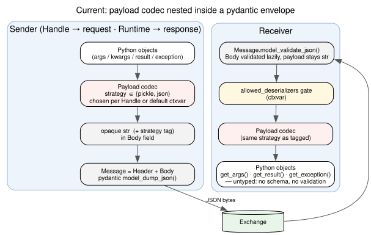
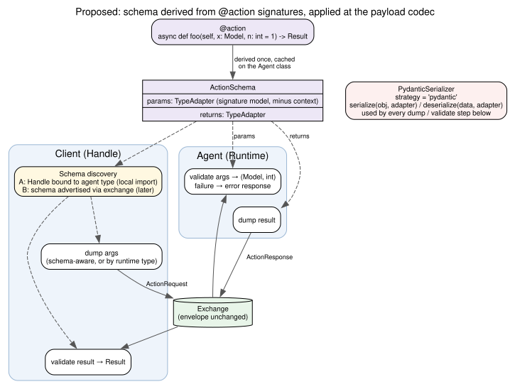

# Design: Pydantic Payload Serialization

**Issue:** [academy-agents/academy#469](https://github.com/academy-agents/academy/issues/469) · **Builds on:** [academy-agents/academy#409](https://github.com/academy-agents/academy/pull/409)

**Goal:** Let action arguments and results be described with Pydantic types, and
use those types to serialize to JSON and validate on receipt. This is a step
toward dropping pickle as the default.

## 1. Background



Messages are encoded in two layers:

- **Envelope** (`academy.message`). `Message` = `Header` + `Body` are Pydantic
  models and always go over the exchange as JSON. They are versioned by
  `PROTOCOL_VERSION`.
- **Payload** (`academy.serialize`). `pargs`, `kargs`, `result` and `exception`
  are opaque strings produced by a `Serializer` (`pickle` or `json`). The
  strategy name travels with the body. The sender picks it (per-`Handle`
  setting, otherwise the `default_serializer` contextvar). The receiver gates it
  with `allowed_deserializers`. Decoding is lazy (`get_args()`, `get_result()`).
- The `json` strategy is **untyped**. It handles only builtins: tuples come back
  as lists, custom types fail, and exceptions become `AcademyRemoteError`. No
  layer knows what type an action expects or returns.

## 2. Proposed approach



1. **The schema comes from the signature.** Each `@action` method's type hints
   become an `ActionSchema`: a params `TypeAdapter` (built from the signature,
   leaving out `context`) and a returns `TypeAdapter`. It is built once and
   cached on the agent class. Users write ordinary type hints and
   `BaseModel`s. There is no separate schema DSL.
2. **Add a `pydantic` strategy.** Add `SerializationStrategy.PYDANTIC` and a
   `PydanticSerializer`. This means widening the `Serializer` protocol to
   accept an optional adapter: `serialize(obj, adapter=None)` and
   `deserialize(data, adapter=None)`. When no adapter is given, it falls back
   to duck-typed dumping (by runtime type) and plain-JSON loading, which is
   still safer than pickle.
3. **Validation happens where the schema lives.**
   - Agent side: requests are validated against `params` before the action
     runs, and results are dumped with `returns`. A validation failure becomes
     an error response; the action never runs.
   - Client side: results are validated against `returns` when the handle
     knows the schema. Two ways it can know:
     - **A (this work):** the `Handle` is bound to its agent type.
     - **B (follow-up):** the schema is advertised through the exchange as
       JSON Schema, which #409 already lists as future work.
4. **The envelope stays the same.** The payload is still a tagged field in
   `Body`, so exchanges, the cloud backend and the `allowed_deserializers`
   gate need no changes. Adding a new strategy value is a minor protocol bump.

## 3. Interface comparison

**Agent definition.** The code is the same in both versions. Type hints that
are ignored today become the wire schema.

```python
class Point(BaseModel):
    x: float
    y: float


class Geo(Agent):
    @action
    async def midpoint(self, a: Point, b: Point) -> Point:
        return Point(x=(a.x + b.x) / 2, y=(a.y + b.y) / 2)
```

**Current**

```python
# pickle (default): works, but the agent must trust the sender.
handle = await manager.launch(Geo)
await handle.midpoint(Point(x=0, y=0), Point(x=2, y=2))  # -> Point

# json: safe, but untyped. Callers hand-convert, and nothing is validated.
handle = Handle(agent_id, request_serializer=SerializationStrategy.JSON)
await handle.midpoint({'x': 0, 'y': 0}, {'x': 2, 'y': 2})  # -> dict
await handle.midpoint('oops', None)  # runs; fails somewhere inside the action
```

**Proposed**

```python
# Opt in per agent, the same way JSON is opted into today.
config = RuntimeConfig(
    default_serializer=SerializationStrategy.PYDANTIC,
    allowed_deserializers={SerializationStrategy.PYDANTIC},
)
handle = await manager.launch(
    Geo, config=config
)  # launch() knows Geo, so it binds the schema

await handle.midpoint(Point(x=0, y=0), Point(x=2, y=2))  # -> Point (validated)
await handle.midpoint(
    {'x': 0, 'y': 0}, {'x': 2, 'y': 2}
)  # -> Point (coerced on the agent side)
await handle.midpoint(
    'oops', None
)  # raises a validation error; the action never runs

# A handle created from an ID alone binds the agent type explicitly.
handle = Handle(
    agent_id, agent_type=Geo, request_serializer=SerializationStrategy.PYDANTIC
)
# Without agent_type: args are still validated by the agent, but the result
# comes back as plain JSON (a dict).
```

The new public surface is small: one enum value (`PYDANTIC`), one optional
`Handle` argument (`agent_type`), and the internal `ActionSchema`.

## 4. Areas of difficulty

| Area | Why it is hard |
|---|---|
| **Client-side result schema** | `Handle[AgentT]` is generic only for static typing. At runtime it knows nothing but an `agent_id`. Typed results need either a binding to the agent class (option A) or schema advertisement (option B). Without either, results come back as plain JSON values. |
| **Signature → model mapping** | The mapping has to cover positional-only params, `*args` and `**kwargs`, defaults, the injected `context` kwarg, and unannotated params (treated as `Any`). Hints under `from __future__ import annotations` and forward refs must be resolved lazily, because the class may not be complete when the decorator runs. |
| **Validation moves out of the message layer** | Today `get_args()` and `get_result()` decode without needing outside information. Validated decoding needs the `ActionSchema`, which the runtime and handle hold but the message does not. The lazy "serialized or not yet" state checks (`isinstance(str)`, the `__serialized__` sentinel) also need a clear owner. |
| **Exceptions** | Arbitrary exceptions have no Pydantic schema. Either reuse the JSON path (`AcademyRemoteError` carrying the traceback text) or define a structured error model. Errors in a payload's own encoding (`ExceptionSerializationError`) must still be reported. |
| **Academy-native objects in payloads** | `Handle`s are often passed as arguments and today rely on `__reduce__`, which is pickle-only. They need a Pydantic core schema (for example, encoded as `agent_id`). |
| **ProxyStore exchange** | `ProxyStoreExchangeTransport` swaps payload items for `Proxy` objects before serialization, so the values no longer match the declared types. The options are a proxy-aware annotation such as `Annotated[T, ...]`, or declaring the two features incompatible. |
| **Cost and compatibility** | `TypeAdapter`s are expensive to build, so build each one once per action. Validated decode makes the receive path slower than pickle. Peers that predate this work reject the unknown `pydantic` strategy, so senders need a fallback until schema advertisement exists. |
